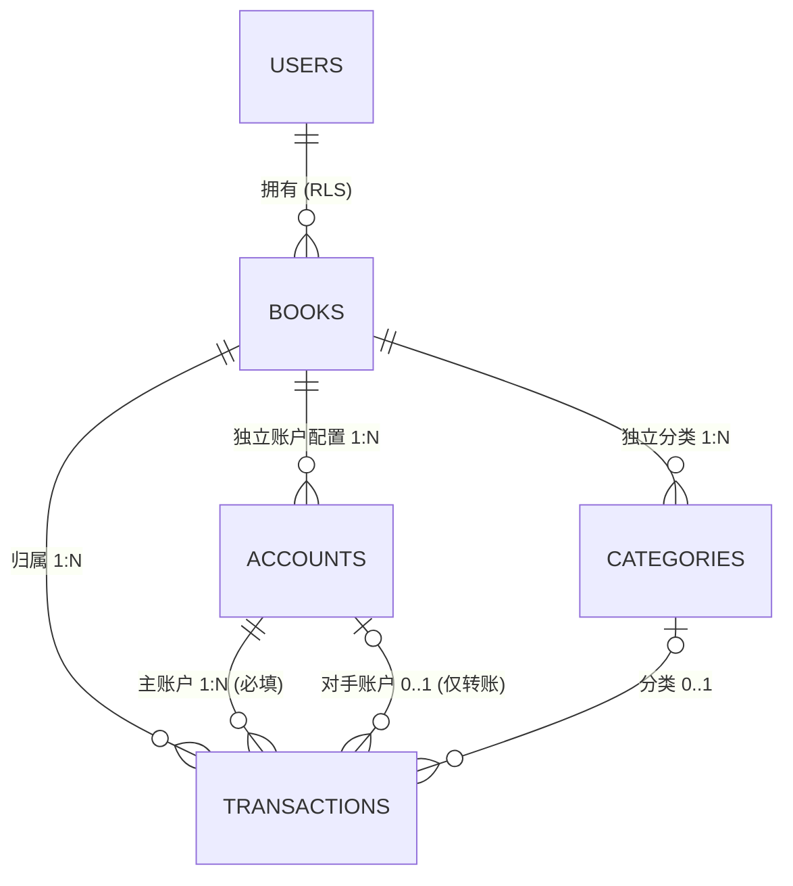
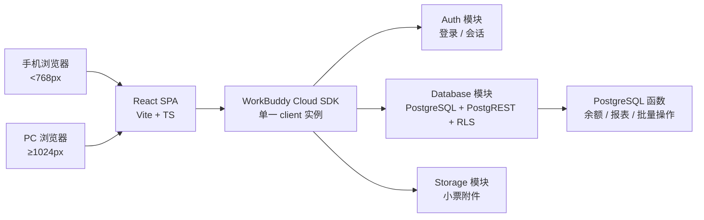

# 多账本记账应用 · 技术设计文档

| 项目  | 内容                             |
| --- | ------------------------------ |
| 版本  | v0.1（设计评审草案）                   |
| 日期  | 2026-11-06                     |
| 状态  | 设计定稿中，待确认项见 §9                 |
| 工作区 | `D:/Tech/codes/accounting-app` |

---

## 1. 背景与目标

### 1.1 业务目标

构建一套个人/家庭/小生意均可使用的记账应用：支持多账本并行记账，每个账本维护自己独立的一套账户配置，流水记录支出、收入与账户间转账，数据保存在云端，手机浏览器与 PC 网页都能获得合适的操作体验。

### 1.2 核心需求（原始约束）

1. **多账本**：一个用户可以拥有多个账本，账本之间数据完全隔离。
2. **每账本独立账户配置**：账户从属于账本，每个账本有各自独立的一套账户清单与账户参数。
3. **流水与账户的关联规则**：
   - 单独的**支出流水**或**收入流水**：关联 **1 个账户**；
   - **转账流水**：关联 **2 个账户**（转出账户 + 转入账户）；
   - 一笔流水最多关联 2 个账户，不允许更多，也不允许 0 个。
4. **云服务存储**：数据持久化在云端，换设备、换浏览器可恢复；不使用 localStorage 作为唯一存储。
5. **双端适配**：页面主要适配手机网页，同时适配 PC 网页。

### 1.3 V1 非目标

| 不做                | 原因                                      |
| ----------------- | --------------------------------------- |
| 多人共享账本            | 会改变 RLS 模型，需 `book_members` + 策略重写，放 P2 |
| 多币种与汇率换算          | V1 单账本单一本位币 CNY，字段已预留 `currency`        |
| 跨账本转账             | 账户专属账本，跨账本会让 `book_id` 归属失去唯一解，见 §5.7   |
| 复式记账 / 凭证 / 科目余额表 | 产品定位是现金流水账，不是会计总账                       |
| 账单自动同步、票据 OCR     | 属于 P2 增强                                |

### 1.4 关键设计取舍

| 决策    | 选择                             | 理由                                  |
| ----- | ------------------------------ | ----------------------------------- |
| 转账表达  | **一条流水 + 两个账户字段**              | 用户明确要求；编辑/删除天然原子，明细不重复，无需双行事务       |
| 账本与账户 | **`accounts.book_id` 外键，一对多**  | 账户专属账本，参数与余额有单一归属；不做多对多中间表          |
| 金额    | **BIGINT 存「分」，恒为正**            | 杜绝浮点误差；方向由 `type` 决定，不存负数           |
| 余额    | **不落库，按流水实时聚合**                | 避免缓存与流水不一致；数据量大时再加月度快照              |
| 后端    | **托管云服务（Auth + DB + Storage）** | 免运维、最快出可用版本；备选自建 Spring Boot，见 §3.4 |
| 多端    | **单一代码库 + 断点布局**               | 不做两套 UI，降低维护成本                      |

---

## 2. 术语与概念模型

| 术语   | 英文 / 字段                   | 定义                                          |
| ---- | ------------------------- | ------------------------------------------- |
| 用户   | `owner_id`                | 登录身份，数据隔离的第一层                               |
| 账本   | `books` / `book_id`       | 一套独立的记账空间，有自己的账户、分类、币种、流水                   |
| 账户   | `accounts` / `account_id` | 资金的存放载体（现金、银行卡、信用卡、电子钱包等），**专属一个账本**        |
| 主账户  | `account_id`              | 流水始终关联的账户：支出=付款方，收入=收款方，转账=转出方              |
| 对手账户 | `counter_account_id`      | 仅转账流水有值，表示转入方                               |
| 流水   | `transactions`            | 一条收支或转账记录，关联 1 或 2 个账户                      |
| 分类   | `categories`              | 支出/收入/转账的分类，可按账本自定义，`book_id IS NULL` 为内置模板 |
| 期初余额 | `initial_balance_cents`   | 账户建档时的起始金额，之后不随意修改                          |



关系要点：

- 用户 → 账本：`1 : N`，靠 RLS 隔离。
- 账本 → 账户：`1 : N`，账户记录本身带 `book_id`，**不是**全局账户池里挑几个。
- 账本 → 流水：`1 : N`，流水带 `book_id`。
- 流水 → 账户：`1 : 1`（支出/收入）或 `1 : 2`（转账），由字段与 CHECK 约束共同保证。
- 不同账本允许同名账户，它们是两条独立记录、两套余额。

---

## 3. 总体架构

### 3.1 架构分层



前端不写服务端接口，所有数据访问经 SDK 的 `cloud.database` 与 `cloud.database.rpc()`；涉及多表或聚合的逻辑下沉到数据库函数。

### 3.2 技术选型

| 层        | 选型                                                  |
| -------- | --------------------------------------------------- |
| 构建       | Vite + React 19 + TypeScript（严格模式）                  |
| 样式       | Tailwind CSS，自定义断点令牌                                |
| 服务端状态    | TanStack Query（queryKey 必须包含 `currentBookId`）       |
| 本地 UI 状态 | Zustand（当前账本、表单草稿、弹层开关）                             |
| 路由       | React Router **HashRouter**（静态托管无 history fallback） |
| 图表       | Recharts                                            |
| 时间与金额    | dayjs；金额解析封装为 `parseCents()`，全链路整数运算                |
| 云服务 SDK  | `@tencent-ai/workbuddy-cloud-sdk@dev`               |
| 测试       | Vitest（金额/余额/转账纯逻辑）+ 关键路径手工验收                       |

### 3.3 云服务方案（主选）

一个应用对应一个独立云环境，启用三个模块：

| 模块       | 用途                                     |
| -------- | -------------------------------------- |
| Auth     | 注册/登录/会话刷新；登录后 SDK 自动把会话附加到每次数据库请求     |
| Database | 托管 PostgreSQL，PostgREST 风格查询，RLS 做用户隔离 |
| Storage  | 小票、凭证图片；数据库只存引用                        |

**客户端初始化约束（必须遵守）**：

- 全应用只创建 **一个** client 实例，`endpoint` / `publishableKey` / `oauthRelayBaseUrl` 全部取自环境返回的 `publicConfig`，禁止硬编码、禁止从 `location` 或环境变量推导。
- 不手写 `fetch` 访问数据面路径，不引入第二个数据库客户端。
- 密钥类凭据不进入前端代码、仓库或日志。
- 静态托管没有 history fallback → 用 HashRouter；OAuth 回调必须落在站点根路径。
- 发布时复用同一个 `applicationId`，保证域名与 Origin 一致，否则云端登录会被拒绝。

### 3.4 自建后端方案（备选）

若需要与既有 Java / Spring Cloud 技术栈对齐：

| 层     | 替换方案                                                      |
| ----- | --------------------------------------------------------- |
| 前端数据层 | 保留 React SPA，把 `cloud.database.*` 换成 REST 客户端（接口路径保持语义一致） |
| 后端    | Spring Boot 3 + MyBatis-Plus / JPA，自己实现鉴权与 `owner_id` 注入  |
| 数据库   | 自建 PostgreSQL，**§4 的 DDL、约束、触发器、函数可原样复用**                 |
| 鉴权    | JWT + Spring Security，RLS 改为服务层强制过滤                       |
| 文件    | MinIO / 对象存储，路径规则同 §6.5                                   |

代价：需自行承担部署、备份、鉴权安全与运维；收益：完全可控、可复用既有基础设施。**数据模型、前端页面与业务规则不变**，只替换数据访问层。

---

## 4. 数据模型

### 4.1 表清单

| 表              | 作用                | 隔离字段                   |
| -------------- | ----------------- | ---------------------- |
| `books`        | 账本                | `owner_id` + 主键        |
| `accounts`     | 账户配置（每账本独立）       | `owner_id` + `book_id` |
| `categories`   | 分类（内置模板 + 每账本自定义） | `owner_id` + `book_id` |
| `transactions` | 流水（支出 / 收入 / 转账）  | `owner_id` + `book_id` |

> 采用「一条流水 + 两个账户字段」后，**不再需要** `transfer_groups` 表。

### 4.2 DDL

```sql
-- 约定：所有业务表均带 owner_id TEXT NOT NULL DEFAULT auth.uid()
-- 约定：金额字段单位一律为「分」，类型 BIGINT

CREATE TABLE books (
  id            BIGINT GENERATED ALWAYS AS IDENTITY PRIMARY KEY,
  owner_id      TEXT NOT NULL DEFAULT auth.uid(),
  name          TEXT NOT NULL,
  type          TEXT NOT NULL DEFAULT 'personal'
                CHECK (type IN ('personal','family','business','travel','other')),
  base_currency TEXT NOT NULL DEFAULT 'CNY',
  icon          TEXT,
  color         TEXT,
  sort_order    INT  NOT NULL DEFAULT 0,
  archived_at   TIMESTAMPTZ,
  created_at    TIMESTAMPTZ NOT NULL DEFAULT now(),
  updated_at    TIMESTAMPTZ NOT NULL DEFAULT now()
);

CREATE TABLE accounts (
  id                    BIGINT GENERATED ALWAYS AS IDENTITY PRIMARY KEY,
  owner_id              TEXT NOT NULL DEFAULT auth.uid(),
  book_id               BIGINT NOT NULL REFERENCES books(id),
  name                  TEXT NOT NULL,
  type                  TEXT NOT NULL CHECK (type IN
                        ('cash','debit_card','credit_card','ewallet',
                         'investment','receivable','liability')),
  initial_balance_cents BIGINT NOT NULL DEFAULT 0,
  currency              TEXT NOT NULL DEFAULT 'CNY',
  include_in_total      BOOLEAN NOT NULL DEFAULT true,
  credit_limit_cents    BIGINT,
  icon                  TEXT,
  color                 TEXT,
  sort_order            INT NOT NULL DEFAULT 0,
  archived_at           TIMESTAMPTZ,
  created_at            TIMESTAMPTZ NOT NULL DEFAULT now()
);

CREATE TABLE categories (
  id          BIGINT GENERATED ALWAYS AS IDENTITY PRIMARY KEY,
  owner_id    TEXT NOT NULL DEFAULT auth.uid(),
  book_id     BIGINT REFERENCES books(id),   -- NULL = 系统内置模板
  parent_id   BIGINT REFERENCES categories(id),
  name        TEXT NOT NULL,
  kind        TEXT NOT NULL CHECK (kind IN ('expense','income','transfer')),
  icon        TEXT,
  color       TEXT,
  sort_order  INT NOT NULL DEFAULT 0,
  archived_at TIMESTAMPTZ,
  created_at  TIMESTAMPTZ NOT NULL DEFAULT now()
);

CREATE TABLE transactions (
  id                  BIGINT GENERATED ALWAYS AS IDENTITY PRIMARY KEY,
  owner_id            TEXT NOT NULL DEFAULT auth.uid(),
  book_id             BIGINT NOT NULL REFERENCES books(id),
  account_id          BIGINT NOT NULL REFERENCES accounts(id),
  counter_account_id  BIGINT REFERENCES accounts(id),
  category_id         BIGINT REFERENCES categories(id),
  type                TEXT NOT NULL CHECK (type IN ('expense','income','transfer')),
  amount_cents        BIGINT NOT NULL CHECK (amount_cents > 0),
  fee_cents           BIGINT NOT NULL DEFAULT 0 CHECK (fee_cents >= 0),
  currency            TEXT NOT NULL DEFAULT 'CNY',
  occurred_at         TIMESTAMPTZ NOT NULL,
  note                TEXT,
  tags                TEXT[] NOT NULL DEFAULT '{}',
  attachment_urls     TEXT[] NOT NULL DEFAULT '{}',
  client_token        TEXT,
  deleted_at          TIMESTAMPTZ,
  created_at          TIMESTAMPTZ NOT NULL DEFAULT now(),
  updated_at          TIMESTAMPTZ NOT NULL DEFAULT now(),

  -- 核心约束：普通收支恰好 1 个账户，转账恰好 2 个不同账户
  CONSTRAINT ck_txn_accounts CHECK (
    (type IN ('expense','income')
       AND counter_account_id IS NULL
       AND fee_cents = 0)
    OR
    (type = 'transfer'
       AND counter_account_id IS NOT NULL
       AND counter_account_id <> account_id)
  )
);
```

### 4.3 索引

```sql
CREATE UNIQUE INDEX uq_accounts_name_active
  ON accounts(book_id, name) WHERE archived_at IS NULL;

CREATE INDEX idx_accounts_book
  ON accounts(book_id, sort_order) WHERE archived_at IS NULL;

CREATE INDEX idx_categories_book ON categories(book_id, kind, sort_order);

CREATE UNIQUE INDEX uq_txn_client_token
  ON transactions(owner_id, client_token) WHERE client_token IS NOT NULL;

CREATE INDEX idx_txn_book_time
  ON transactions(book_id, occurred_at DESC) WHERE deleted_at IS NULL;

CREATE INDEX idx_txn_account_time
  ON transactions(account_id, occurred_at DESC) WHERE deleted_at IS NULL;

CREATE INDEX idx_txn_counter_time
  ON transactions(counter_account_id, occurred_at DESC)
  WHERE counter_account_id IS NOT NULL AND deleted_at IS NULL;

CREATE INDEX idx_txn_category
  ON transactions(category_id) WHERE deleted_at IS NULL;
```

`uq_accounts_name_active` 用**部分唯一索引**：同一账本内未归档账户不重名；跨账本允许重名；归档后名字可复用。

### 4.4 触发器：账户与账本一致性

```sql
CREATE OR REPLACE FUNCTION validate_txn_accounts() RETURNS TRIGGER AS $$
DECLARE v_book BIGINT;
BEGIN
  SELECT book_id INTO v_book FROM accounts WHERE id = NEW.account_id;
  IF v_book IS DISTINCT FROM NEW.book_id THEN
    RAISE EXCEPTION 'account_id % 不属于账本 %', NEW.account_id, NEW.book_id;
  END IF;

  IF NEW.counter_account_id IS NOT NULL THEN
    SELECT book_id INTO v_book FROM accounts WHERE id = NEW.counter_account_id;
    IF v_book IS DISTINCT FROM NEW.book_id THEN
      RAISE EXCEPTION 'counter_account_id % 不属于账本 %',
        NEW.counter_account_id, NEW.book_id;
    END IF;
  END IF;

  RETURN NEW;
END;
$$ LANGUAGE plpgsql SECURITY DEFINER;

CREATE TRIGGER trg_txn_accounts
BEFORE INSERT OR UPDATE OF book_id, account_id, counter_account_id
ON transactions FOR EACH ROW EXECUTE FUNCTION validate_txn_accounts();
```

作用是让「账户专属账本」在数据库层闭环：即使前端传错 `book_id` 或选了别的账本的账户，写入也会被拒绝。分类归属校验同理可扩展。

### 4.5 RLS 策略

```sql
-- 对 books / accounts / transactions 各执行一遍（把表名替换即可）
ALTER TABLE books ENABLE ROW LEVEL SECURITY;
CREATE POLICY books_owner ON books FOR ALL
  USING (owner_id = auth.uid())
  WITH CHECK (owner_id = auth.uid());

-- categories 额外允许所有人读取内置模板
ALTER TABLE categories ENABLE ROW LEVEL SECURITY;
CREATE POLICY categories_owner ON categories FOR ALL
  USING (owner_id = auth.uid())
  WITH CHECK (owner_id = auth.uid());
CREATE POLICY categories_read_template ON categories FOR SELECT
  USING (book_id IS NULL);
```

规则：


- 前端 **insert 时不传 `owner_id`**，由 `DEFAULT auth.uid()` 填充，RLS 校验。
- 前端不在 JS 里做「这条数据是不是我的」判断，只用于决定是否显示编辑按钮。
- 写操作链式 `.select()` 检查受影响行数：返回空数组通常是被 RLS 拦下，不能当成成功。

### 4.6 两层数据隔离

| 层 | 机制 | 挡住什么 |
|---|---|---|
| 用户级 | RLS `owner_id = auth.uid()` | 别人看不到你的任何账本、账户、流水 |
| 账本级 | 业务查询强制 `WHERE book_id = :currentBookId` | 你自己的 A 账本数据不串到 B 账本 |

`book_id` 这层 RLS 帮不上忙，必须由应用层保证：所有列表、下拉、余额、报表的 query 都带当前账本 ID；全局「当前账本」上下文切换时使相关 query 全部失效。

### 4.7 初始化模板

新建账本时在**单事务**内复制一套默认配置（之后独立演化，共享的是模板而非运行时记录）：

- 账户：现金、储蓄卡、微信钱包、支付宝（各 `initial_balance_cents = 0`）。
- 分类：内置模板（`book_id IS NULL`）只读引用；如需自定义，复制成 `book_id = 新账本` 的行。
- 账本软删除时，其账户、分类、流水一并归档，不做物理删除。

---

## 5. 核心业务规则

### 5.1 流水类型与账户关联

| type | `account_id` | `counter_account_id` | 账户数 | 含义 |
|---|---|---|---|---|
| `expense` | 必填 | 必须为 NULL | 1 | 从主账户付出 |
| `income` | 必填 | 必须为 NULL | 1 | 存入主账户 |
| `transfer` | 必填（转出） | 必填（转入），且不等于主账户 | 2 | 账本内两个账户之间搬家 |

约束由 §4.2 的 `ck_txn_accounts` CHECK 强制，前端写错也进不来。

### 5.2 金额与方向

- `amount_cents` **恒为正整数**，单位「分」；方向由 `type` 决定，禁止存负数。
- 表单输入用字符串解析成整数分（`parseCents`），中间计算全程整数，只在展示层格式化为 `¥ x,xxx.xx`。
- `fee_cents` 仅转账可用，从转出方额外扣除。
- `currency` 与账本 `base_currency` 一致（V1 单币种）。

### 5.3 余额计算

余额 **不落库字段**，由数据库函数按 `type` 分支聚合：

```
余额(A) = initial_balance_cents(A)
        + Σ(income   且 account_id = A 的 amount_cents)
        - Σ(expense  且 account_id = A 的 amount_cents)
        - Σ(transfer 且 account_id = A 的 amount_cents + fee_cents)
        + Σ(transfer 且 counter_account_id = A 的 amount_cents)
```

```sql
CREATE OR REPLACE FUNCTION account_balance(
  p_account_id BIGINT, p_as_of TIMESTAMPTZ DEFAULT now()
) RETURNS BIGINT AS $$
  SELECT a.initial_balance_cents + COALESCE((
    SELECT SUM(CASE
      WHEN t.type = 'income'   AND t.account_id = a.id THEN  t.amount_cents
      WHEN t.type = 'expense'  AND t.account_id = a.id THEN -t.amount_cents
      WHEN t.type = 'transfer' AND t.account_id = a.id
                                                THEN -(t.amount_cents + t.fee_cents)
      WHEN t.type = 'transfer' AND t.counter_account_id = a.id
                                                THEN  t.amount_cents
      ELSE 0 END)
    FROM transactions t
    WHERE t.deleted_at IS NULL
      AND t.occurred_at <= p_as_of
      AND (t.account_id = a.id OR t.counter_account_id = a.id)
  ), 0)
  FROM accounts a WHERE a.id = p_account_id;
$$ LANGUAGE sql STABLE SECURITY DEFINER;
```

数据量增长后（单账户流水 > 10 万条），增加 `account_balance_snapshots` 月度快照表，改为「快照 + 快照后增量」，前端接口不变。

### 5.4 报表口径

| 报表 | 口径 |
|---|---|
| 月度收入 / 支出 | 只统计 `type IN ('income','expense')`；**转账不计入**，避免虚增收支 |
| 净结余 | 收入 − 支出（不含转账，转账不改变账本总余额） |
| 分类占比 | 按 `category_id` 聚合，排除转账；未分类归入「其他」 |
| 账户余额分布 | 对每个账户调 `account_balance`，`include_in_total = false` 的不计入总资产 |
| 账户资金流动 | 可单独看转账，按「转出 / 转入」两个方向统计 |

### 5.5 转账

- 一条转账 = 一条 `type='transfer'` 的流水，两个账户字段都填。
- 编辑、删除是单行操作，**天然原子**，无需跨行事务。
- 明细列表中渲染为「招行卡 → 微信钱包」，金额用中性色，带「转账」标签。
- 同一条转账会同时出现在两个账户的流水里（查询条件 `account_id = X OR counter_account_id = X`），这是预期行为：在转出账户视角显示 `−amount`，在转入账户视角显示 `+amount`。
- 转出/转入下拉互斥：选了 A，B 的候选列表过滤掉 A。

### 5.6 生命周期规则

| 对象 | 删除策略 |
|---|---|
| 账本 | 软删除（`archived_at`）+ 二次确认；其账户/分类/流水一并归档 |
| 账户 | 一旦有流水，**禁止物理删除**，只能归档（否则历史余额断裂）；无流水可硬删 |
| 流水 | 软删除 `deleted_at`；所有查询与余额函数都过滤 `deleted_at IS NULL` |
| 分类 | 软删除；已被流水引用的分类保留，仅在下拉中隐藏 |

余额函数、明细、报表一律以 `deleted_at IS NULL` 与 `archived_at IS NULL` 为准。

### 5.7 跨账本转账（V1 不支持）

因为账户专属账本且 §4.4 的触发器要求两个账户与流水同账本，转账天然是**账本内**的。UI 上转出/转入下拉只列当前账本账户，从源头不给选错机会。

若 P2 要支持「日常账本的招行卡 → 副业账本的对公卡」，需额外建模，两个候选方案：

1. **两账本各记一笔 + `link_id` 关联**：在 A 账本记一条转出流水、B 账本记一条转入流水，用 `link_id` 串起来；编辑/删除需在单事务内同步两条。
2. **账本间往来虚拟账户**：每个账本建一个「账本间往来」账户，跨账本转账拆成两次账本内转账。

方案 1 更贴近现有模型，推荐；但会重新引入多记录一致性问题，需单独立项。

---

## 6. 云服务端设计

### 6.1 RPC 清单

前端只调用这些数据库函数做聚合与批量操作，普通 CRUD 走 `cloud.database.from()`：

| 函数 | 作用 |
|---|---|
| `account_balance(account_id, as_of)` | 单账户余额 |
| `book_balance_snapshot(book_id, as_of)` | 一次返回账本下所有账户余额，避免 N+1 |
| `book_monthly_summary(book_id, month)` | 月收入、月支出、净结余、转账总额 |
| `category_breakdown(book_id, from, to, kind)` | 分类占比 |
| `daily_trend(book_id, from, to)` | 每日收支柱状/趋势 |
| `create_transaction(payload)` | 带幂等校验的流水创建（可选，触发器已兜住一致性） |
| `archive_book(book_id)` | 单事务内归档账本及其账户、分类 |
| `init_book_template(book_id)` | 单事务内初始化默认账户与分类 |

### 6.2 认证

- 登录方式见 §9 待确认；Web 端支持手机号短信验证码 / 邮箱 OTP / 微信扫码或快捷登录。
- 登录门禁：任何涉及用户数据的查询前，先确保 `cloud.auth.getSession()` 有会话；未登录时渲染登录页，不做匿名登录、不用本地假会话绕过。
- 登录后 SDK 自动携带会话，数据层代码无需改动。

### 6.3 幂等与并发

- 前端每次提交生成 `client_token`（UUID），随流水插入；`uq_txn_client_token` 唯一索引保证重复点击/弱网重试只产生一条记录。
- 重复提交命中 `23505` 时，前端按「已保存」处理并回查该条流水，不弹错误。
- 多表操作（账本初始化、归档）走 RPC 单事务，避免半截数据。
- 离线草稿（P2）沿用同一个 `client_token`，联网后直接重放。

### 6.4 Storage

- 路径：`{owner_id}/{book_id}/{yyyyMM}/{client_token}_{index}.{ext}`。
- 白名单：`jpg / png / webp / pdf`，单文件 ≤ 5 MB，后端/前端双侧校验。
- 不信任客户端提供的文件名与路径，服务端生成；数据库只存引用 URL。

### 6.5 错误处理

| 场景 | 处理 |
|---|---|
| `error` 有值 | 按 `error.code` 分支：`23505` 重复、`42501` 无权限、`42P01` 表不存在 |
| 写操作 `.select()` 返回空数组 | 视为「未生效 / 被 RLS 拦截」，提示而非静默成功 |
| 未登录 / 会话过期 | 跳转登录并保留当前账本与表单草稿 |
| 网络失败 | 保留表单草稿，提示重试，不重复提交（复用 `client_token`） |
| 额度 / 计费异常 | 明确提示用户检查云服务状态，不按瞬时错误重试 |

### 6.6 安全

- 前端只持有 `publicConfig` 中的公开配置；长期密钥、服务角色凭据不进入代码、仓库或日志。
- 日志与错误信息不输出 token、手机号、邮箱、私有文件 URL、原始行数据。
- 所有用户数据读写经过 RLS；前端过滤只用于展示，不作为安全边界。
- 破坏性操作（清空数据、批量删除）需二次确认并说明影响范围。

---

## 7. 前端设计

### 7.1 页面清单

| 页面 | 内容 |
|---|---|
| 登录 / 注册 | 选定登录方式，会话建立 |
| 账本列表 | 新建、切换、排序、归档账本 |
| 概览（首页） | 本月收入/支出/结余、账户余额列表、最近流水、快捷记账入口 |
| 记一笔 | 金额、类型、**账户（1 或 2 个）**、分类、日期、备注、标签、小票 |
| 流水明细 | 按天分组、筛选（账户/分类/时间/关键字）、编辑、删除 |
| 流水详情 | 单条完整信息，转账显示两个账户与方向 |
| 账户详情 | 余额、该账户全部流水（含转账两侧） |
| 报表 | 月度趋势、分类占比、账户余额分布 |
| 账本设置 | **账户配置**、分类配置、本位币、模板初始化 |
| 我的 | 账号信息、导出 CSV、归档内容管理 |

### 7.2 响应式断点

| 断点 | 布局 |
|---|---|
| `< 768px` 手机（主适配） | 底部 5 项 Tab（概览/明细/记账/报表/我的）、右下悬浮记账按钮、单列卡片流、按天分组明细、记账表单用全屏 Sheet、数字键盘 |
| `768–1023px` 平板 | 窄侧栏 + 单列内容，表单用居中模态框 |
| `≥ 1024px` PC | 左侧固定账本导航（账本切换器 + 菜单）、中间明细表格（可排序/批量编辑）、右侧统计面板；记账用居中 Modal；快捷键 `N` 新建、`Esc` 关闭 |

同一套组件，靠 CSS 断点与容器查询切换；不做两套 UI。支出用红、收入用绿、转账用中性色，符合国内用户习惯。

### 7.3 状态与数据获取

- Zustand 只存：`currentBookId`、表单草稿、弹层开关、筛选条件。
- 服务端状态全部交给 TanStack Query，`queryKey` 一律包含 `currentBookId`；切换账本时使该账本相关 query 失效并重新拉取。
- 余额、报表一律取 RPC 结果，前端不做金额累加。
- 记账表单的账户下拉数据源：`.from('accounts').select('*').eq('book_id', currentBookId).is('archived_at', null)`。

### 7.4 路由（HashRouter）

```
#/login
#/books
#/book/:bookId/overview
#/book/:bookId/transactions
#/book/:bookId/txn/:txnId
#/book/:bookId/accounts/:accountId
#/book/:bookId/reports
#/book/:bookId/settings
#/me
```

### 7.5 记账表单规格

| type | 账户控件 | 必填校验 |
|---|---|---|
| 支出 | 「付款账户」单选 | 金额 > 0、付款账户、分类、日期 |
| 收入 | 「收款账户」单选 | 金额 > 0、收款账户、分类、日期 |
| 转账 | 「转出账户」+「转入账户」双选，互斥 | 金额 > 0、两个不同账户、日期；手续费可选 |

切换 type 时清空对手账户字段，避免残留触发 CHECK 约束失败。所有账户候选都按当前账本过滤。

---

## 8. 实施计划与验收

### 8.1 分期

| 阶段 | 范围 | 验收标准 |
|---|---|---|
| **P0 MVP** | 登录、账本 CRUD、每账本独立账户配置、流水 CRUD（1 或 2 账户约束）、转账、余额计算、明细列表、月度收支报表、手机 + PC 响应式 | 手机记一笔 → PC 登录可见；余额与报表一致；删改流水后余额重算正确 |
| **P1** | 自定义分类、预算、小票上传、搜索筛选、CSV 导出、账户归档、账本模板初始化 | 转账后两账户余额一增一减、收支报表不受影响；重复提交不产生两笔 |
| **P2** | 共享账本/多人协作、多币种与汇率、周期记账、账单导入、PWA 离线草稿、智能分类、跨账本转账 | 成员权限隔离；离线草稿联网后幂等同步 |

### 8.2 P0 任务拆解

1. 创建前端工程与依赖，配置 SDK client（单实例，配置取自 `publicConfig`）。
2. 建表：§4.2 DDL + §4.3 索引 + §4.4 触发器 + §4.5 RLS。
3. 实现 §6.1 的 `account_balance` / `book_balance_snapshot` / `book_monthly_summary` 三个函数。
4. 登录页 + 会话门禁。
5. 账本列表与全局「当前账本」上下文。
6. 账本设置里的账户配置（增删改、排序、归档）。
7. 记一笔表单（三种 type + 账户互斥 + 整数分金额）。
8. 明细列表、详情、编辑、软删除。
9. 概览与月度报表。
10. 响应式布局与双端走查。
11. 验收清单逐项验证。

### 8.3 P0 验收清单

- [ ] 两个账本各建一个同名「微信钱包」，余额互不干扰。
- [ ] A 账本的账户下拉里不出现 B 账本的账户。
- [ ] 支出/收入流水 `counter_account_id` 为空；传值会被 CHECK 拒绝。
- [ ] 转账两个账户必填且不相同；传不同账本的账户会被触发器拒绝。
- [ ] 转账后转出账户减、转入账户加，账本总余额不变。
- [ ] 月度收入/支出报表不因转账而增加。
- [ ] 删除/编辑流水后，相关账户余额立即重算正确。
- [ ] 连续快速提交两次同一笔，只产生一条记录。
- [ ] 换浏览器登录后数据与余额一致。
- [ ] 另一个账号无法读写本账号数据（RLS）。
- [ ] 手机与 PC 均能完成「记一笔 → 查看明细 → 看报表」完整链路。

### 8.4 测试重点

金额整数边界（0.01 元、大额、精度）、转账两侧余额对称性、CHECK 约束与触发器拒绝路径、RLS 跨用户隔离、账本切换后的缓存失效、幂等重放、软删除后余额与报表口径。

---

## 9. 待确认决策

| # | 决策 | 建议默认值 | 影响面 |
|---|---|---|---|
| 1 | 后端形态：托管云服务 / 自建 Spring Boot | 托管云服务 | §3.3 / §3.4，数据访问层 |
| 2 | 登录方式：手机号验证码 / 微信登录 / 邮箱 OTP | 手机号验证码 + 微信登录 | §6.2，OAuth 回调配置 |
| 3 | 跨账本转账 V1 是否支持 | 不支持，放 P2 | §5.7，触发器是否放宽 |
| 4 | 是否需要离线记账（PWA 草稿） | P2 | §6.3 同步与幂等 |
| 5 | 共享账本/多人协作优先级 | P2 | RLS 模型重写 |

---

## 10. 变更记录

| 版本 | 日期 | 变更 |
|---|---|---|
| v0.1 | 2026-11-06 | 首版设计文档。确立「一条流水关联 1 或 2 个账户」模型、`accounts.book_id` 一对多独立账户配置、整数分金额、余额实时聚合、云服务三模块、双端响应式与三期路线 |

> 说明：早期讨论中曾考虑「转账拆成两笔流水 + transfer_groups」，已按需求明确改为单条流水双账户字段，相关表与事务设计一并移除。
